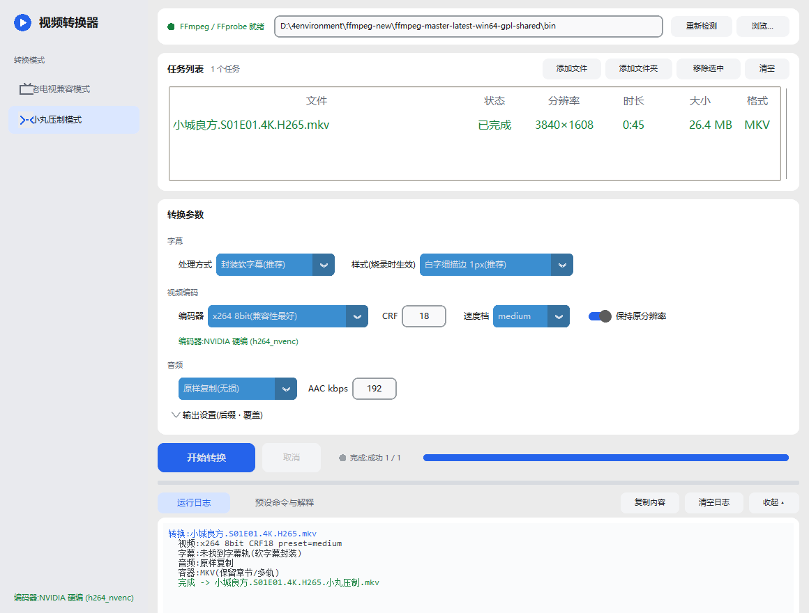
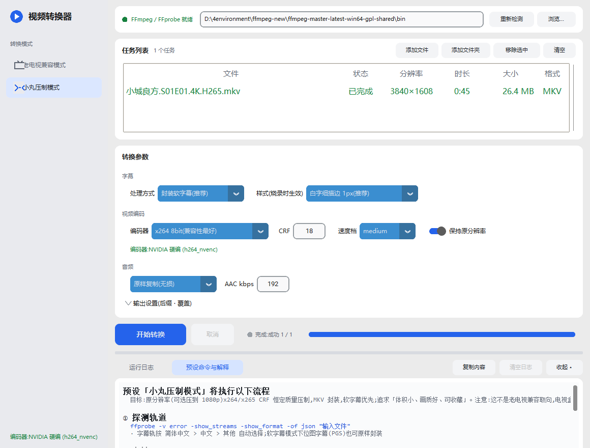

<div align="center">

# tv_ffmpeg_converter

**一款基于 FFmpeg 的 Windows 视频转换工具:老电视兼容 × 小丸压制,双模式一键批量转换**

[](#)
[](#)
[](#)
[](#)

*界面预览(小丸压制模式,转换完成状态)*



</div>

---

## 这是什么

把下载到的任意视频(4K / 2K / 1080p …)用**预设**一键转成目标格式,输出文件直接生成在原视频的同一目录。提供两套取向完全不同的模式:

| | 🖥 老电视兼容模式 | 🎞 小丸压制模式 |
|---|---|---|
| 目标 | **兼容性优先**:老电视、电视盒子、平板都能放 | **画质/体积优先**(参考小丸工具箱思路):收藏、电脑、高清播放器 |
| 分辨率 | 任意输入 → 1920×1080,非 16:9 自动垫黑边,不拉伸变形 | 默认保持原分辨率,可选压到 1080p |
| 视频编码 | H.264 High@4.1(老解码器通吃),优先 NVIDIA 硬编,码率可调 | x264 8bit / x264 10bit / x265 10bit,**CRF 恒定质量**,速度档可选 |
| 音频 | 源是 AAC 立体声 → 原样复制;否则转 AAC 立体声(5.1 自动下混) | 默认原样复制(无损),可选压制 AAC |
| 字幕 | 自动挑简中轨**烧录**进画面(7 种预设样式,1px 描边等) | 默认**软字幕封装**进 MKV(能封装不烧录),也可选烧录 |
| 封装 | MP4 + faststart | MKV(保留章节、多轨道) |
| 输出命名 | `原名.1080p.老电视.mp4` | `原名.小丸压制.mkv` |

> 两套模式分开的原因:10bit、MKV 软字幕这些"收藏级"特性恰恰是老电视不兼容的——兼容性和画质体积不可兼得,所以拆成两个预设。



## ✨ 主要功能

- **双模式批量转换**,输出到原视频同一目录,可配置文件名后缀、是否覆盖
- **任务列表**:显示真实的分辨率 / 时长 / 大小 / 格式(由 ffprobe 探测,拿不到的不造假)、行状态实时流转(待转换 → 转换中 → 已完成 / 失败 / 已跳过 / 已取消)、列头点击排序
- **资源管理器拖入文件**、多选移除、空状态引导
- **字幕**:简体中文轨自动识别(简体 > 中文 > 其他文本轨),7 种内置样式;位图字幕(PGS)在软字幕模式下可原样封装
- **转换控制**:真实进度、当前文件序号、ffmpeg 上报的实时速度 / 帧率;一键取消(等待 ffmpeg 进程实际退出)
- **日志与命令面板**:彩色日志、一键复制;「预设命令与解释」页实时展示将要执行的完整命令与逐参数说明
- **NVENC 自动探测**:有 N 卡用硬编,没有自动回退 libx264;编码器状态常驻侧栏
- **细节**:浅色主题、数字参数实时校验(错误红框 + 提示)、快捷键、日志区可折叠可拖高

## 🖥 环境要求

| 依赖 | 说明 |
|---|---|
| Windows 10/11 | 开发与测试平台 |
| [Python](https://www.python.org/) 3.8+ | 界面用;需安装 `customtkinter`(必需)与 `tkinterdnd2`(拖拽,可选) |
| [FFmpeg / FFprobe](https://www.gyan.dev/ffmpeg/builds/) 6.0+ | 建议全功能 GPL 构建(需含 libx264 / libx265;硬编需含 h264_nvenc) |
| NVIDIA 显卡(可选) | 没有也能用,自动回退 CPU 软编 |

## 🚀 快速开始

```bat
git clone https://github.com/xyblue135/tv_ffmpeg_converter.git
cd tv_ffmpeg_converter
python -m pip install customtkinter tkinterdnd2
```

然后双击 **`启动转换器.bat`**(或 `python gui.py`)。

1. 首次启动点侧栏的自动探测,或手动指定 ffmpeg 所在目录(程序也会按 PATH 与常见位置自动查找)
2. 拖入(或添加)视频文件
3. 选择模式与参数 → **开始转换**
4. 完成后到原视频目录找输出文件

### 命令行批量(不打开界面)

```bat
rem 老电视兼容模式
python converter.py "D:\剧集目录" --mode "老电视兼容模式" --bitrate 6000

rem 小丸压制模式:x265 CRF20,软字幕,音频复制
python converter.py "D:\剧集目录" --mode "小丸压制模式" --enc x265 --crf 20 --speed slow
```

## ⚙️ 工作原理(以老电视兼容模式为例)

程序按三步执行,每一步都可在界面「预设命令与解释」页看到实时生成的完整命令:

1. **探测轨道** — `ffprobe -show_streams -show_format -of json`,自动选择简中字幕轨与音轨
2. **提取字幕** — 内嵌字幕转纯文本 SRT,按所选样式重排为 `PlayRes=1920×1080` 的 ASS(样式数值即屏幕真实像素)
3. **主转码** —

```bat
ffmpeg -y -i "输入文件" -map 0:v:0 -map 0:<音轨号> -sn -dn ^
  -vf "scale=trunc(iw*max(sar,1)/2)*2:trunc(ih/2)*2,setsar=1,scale=1920:1080:force_original_aspect_ratio=decrease:flags=lanczos,scale=trunc(iw/2)*2:trunc(ih/2)*2,pad=1920:1080:(ow-iw)/2:(oh-ih)/2:black,subtitles=subs.ass,format=yuv420p" ^
  -c:a copy -map_metadata 0 -movflags +faststart ^
  -c:v h264_nvenc -preset p5 -rc vbr -b:v 6000k -maxrate 9000k -bufsize 12000k ^
  -profile:v high -level 4.1 "输出.1080p.老电视.mp4"
```

滤镜链逐段作用:非方形像素归一(防变形)→ 等比缩放进 1080p → 宽高取偶 → 居中垫黑边 → 烧录字幕 → 统一像素格式。
小丸模式的等价命令与参数解释同理,见 `converter.py` 中的 `preview_plan()`。

## ⌨️ 快捷键

| 快捷键 | 功能 |
|---|---|
| `Ctrl + O` | 添加文件 |
| `Ctrl + 1` / `Ctrl + 2` | 切换 老电视兼容 / 小丸压制 模式 |
| `Ctrl + Enter` | 开始转换 |
| `Esc` | 取消当前转换 |
| `Delete` | 移除选中的任务 |

## ❓ 常见问题

- **提示找不到 ffmpeg?** 在「FFmpeg 位置」填写 ffmpeg.exe 所在目录(ffmpeg 与 ffprobe 必须同目录),或将其加入 PATH
- **HDR 片源转出来颜色发灰?** 当前版本未做 HDR→SDR 色调映射,只转格式;日志中会提示。计划支持
- **小丸模式输出的 MKV 老电视放不了?** 正常——10bit、软字幕本来就是收藏级特性,给老电视请用「老电视兼容模式」
- **拖拽不生效?** 确认安装了 `tkinterdnd2`;未安装时程序照常运行,只是没有拖拽(空状态提示会如实说明)
- **字幕轨是 PGS 位图?** 老电视模式无法烧录位图字幕,会跳过并在日志提示;小丸模式软字幕封装不受影响
- **输出文件已存在?** 默认跳过并记录日志,勾选「覆盖已存在的输出文件」后重转

## 🗂 项目结构

```
tv_ffmpeg_converter/
├── converter.py        # 核心转换逻辑(轨道探测、字幕提取、SRT→ASS、滤镜链、编码),不依赖界面
├── gui.py              # CustomTkinter 界面(设计令牌集中管理:THEMES / SP / 控件规格)
├── 启动转换器.bat       # 双击启动
└── docs/               # 截图
```

## 🛠 二次开发提示

- 界面与业务完全解耦:对 ffmpeg 的全部"接口"就是几条命令行,见 `convert_file()` / `preview_plan()`
- 新增预设只需在 `SUB_STYLES` / `ConvertOptions` 里加字段,界面与命令预览自动跟随
- **移植 Java**:核心就是 ffprobe JSON 解析 + 命令拼装 + 进度行解析(`out_time_us` / `speed=`),README 与 `preview_plan()` 即接口文档;注意旧版 ffmpeg 的 `out_time_ms` 单位是微秒
- 运行期用户配置保存在 `~/.tv_converter_gui.json`

## 📄 许可证

暂未设置开源许可证(保留所有权利)。个人使用、学习不受限;如需引用或分发代码,请先开 Issue 联系。

---

<div align="center">用 FFmpeg 命令行攒出来的小工具,欢迎 Issue 与 Star ⭐</div>
